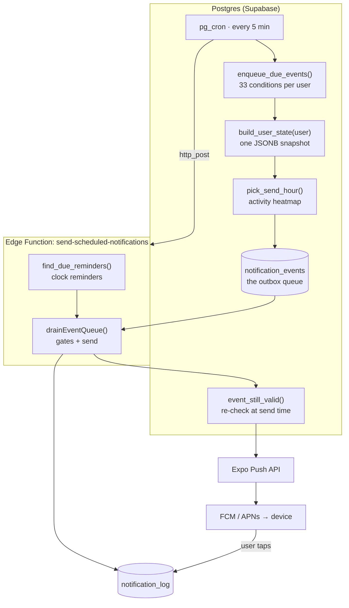
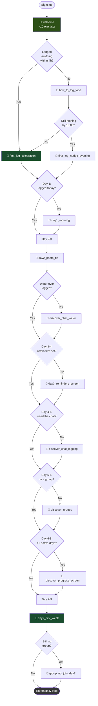
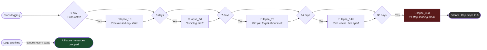
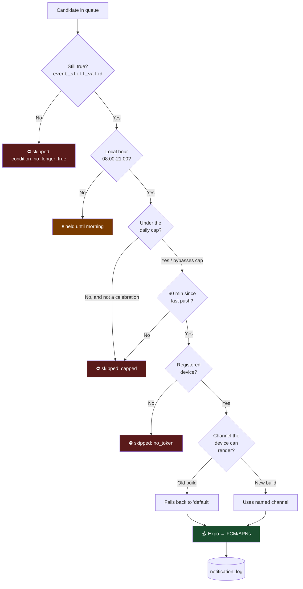

# STEADY — The Notification System

> Complete reference for how STEADY decides what to say to a user, when to say it,
> and whether to say anything at all.
>
> **Status:** live in production · **Last updated:** 2026-09-02
>
> Open bugs and gaps are tracked in [`STATUS.md`](STATUS.md); §12 below mirrors them.

---

## Contents

1. [Status at a glance](#1-status-at-a-glance)
2. [Philosophy](#2-philosophy)
3. [Architecture](#3-architecture)
4. [The database](#4-the-database)
5. [Edge Functions](#5-edge-functions)
6. [App-side code](#6-app-side-code)
7. [The messages](#7-the-messages)
   - [7a. User flow: which message fires when](#7a-user-flow-which-message-fires-when) — *flow charts*
   - [7b. The complete message catalogue](#7b-the-complete-message-catalogue) — *all 225 messages*
8. [Timing: when notifications are sent](#8-timing-when-notifications-are-sent)
9. [The safety rails](#9-the-safety-rails)
10. [Old app versions](#10-old-app-versions)
11. [Research and inspiration](#11-research-and-inspiration)
12. [Known gaps](#12-known-gaps)
13. [Runbook](#13-runbook)
14. [Migration history](#14-migration-history)

---

## 1. Status at a glance

| Metric | Value |
|---|---|
| Total users | 31 |
| Users with a push token | 21 |
| Users with a timezone set | 26 |
| **Reachable** (token **and** timezone) | **21** |
| Users who set a reminder themselves | 1 |
| Active message templates | 273 |
| ↳ event templates | 225 |
| ↳ clock-reminder templates | 48 |
| Event types defined | 33 |
| Events currently queued | 55 |
| Events delivered since go-live | 6 |
| Events correctly capped | 7 |

The number that matters: **reach went from 1 user to 21**, and none of it required a user to
open the app, change a setting, or update their build.

---

## 2. Philosophy

### Clocks versus events

STEADY used to have only **clocks**. A user opened the Reminders screen, typed a time, and got
a ping at that time forever. The clock knows nothing about them.

The problem was measurable: **1 user out of 24 had ever set a reminder.** The other 23 had
granted push permission and were being sent nothing at all, because the entire system was
waiting to be configured by people who never configured it.

So we added **events**. An event is a *reaction*: the system notices something true about a
person and responds. Nobody schedules it, nobody opts in, and that is precisely why it reaches
people the clock could never reach.

```
CLOCK   "Ping me at 8am"                 user configures  →  fires regardless of context
EVENT   "You haven't logged in 3 days"   system notices   →  fires because it is true
```

Both still exist. Clocks serve people who want a specific time; events serve everyone.

### A friend observes, a system instructs

The single most important copywriting rule here, and the one that reframed all 225 messages.

The notifications people keep switched on **observe** rather than **instruct**. Zomato's best
line contains no call to action whatsoever:

> "Dinner plans? Let's be real, it's you and your couch again."

Our first draft was roughly 90% imperatives — *log this, snap that, drink water*. Imperative
mood is the grammar of machines, because a machine's only relationship to you is making you do
things. Observational mood implies **someone noticed**.

| Before (machine) | After (human) |
|---|---|
| Stay hydrated. Log some water. | **You are a houseplant 🪴** / Currently under-watered 💧 |
| Nothing logged today. | **Day one and already ghosting 👀** / I thought we had something 😅 |
| Lunch not logged. | **Still running on chai? ☕** / It's 1:30. That's not lunch 🍽️ |

### An unread notification is not free

Every message spends goodwill. The research is blunt: **3 or more notifications per day drops
open rates below 5% and pushes weekly opt-out to 5–8%**, and **71% of users have uninstalled an
app over notification volume.** So the system is built to send *less* than it could, and every
gate defaults to silence.

### Provocation, never shame

Rage-bait works for engagement and damages trust — 73% of consumers report reduced trust in
brands that use it. We kept the technique but drew a hard line: **provocation aimed at the
user's competitive instinct, never at their body or their eating.**

- ✅ "Bet you won't log dinner 👀 / You never do 🍽️" — a dare
- ❌ "Scared of the number?" on a weigh-in — a trigger, in an app whose users have complicated
  relationships with food

`medicine` reminders get no rage-bait variant at all. Mocking medical adherence is not edgy.

---

## 3. Architecture

Nothing here needs an always-on server. A `pg_cron` job inside Postgres makes an HTTP call
every five minutes, and everything else follows from that.



### The two halves

**Enqueuer** (SQL, in Postgres). Walks every reachable user, takes one `build_user_state()`
snapshot each, evaluates all 33 conditions against it, and writes candidates into the queue.
One snapshot per user means all 33 decisions are made from a single consistent view of that
person rather than 33 racing queries.

**Drainer** (TypeScript, in the Edge Function). Pulls due candidates, runs them through the
gates, and sends the survivors.

### Why a queue in the middle

The gap between *noticing* and *sending* is where all the useful behaviour lives. A queued
message can be re-evaluated, delayed to a better hour, out-prioritised by something more
important, or dropped because the user did the thing already.

### Why conditions are re-checked, not cancelled

An earlier design had database triggers on `meal_logs`, `water_logs`, `chat_messages` and
`group_members` deleting queued rows when a user acted. We rejected it: that is a trigger per
table, each duplicating a rule that lives elsewhere, and each free to drift out of sync with
it. **This codebase produced exactly that failure twice in one week** (a streak cache that
silently stopped updating, and `find_due_reminders` losing an output column across two
migrations).

Instead the queue holds a *candidate*, and `event_still_valid()` re-reads live state at the
moment of sending. Nothing to keep in sync, and the check is current by construction.

---

## 4. The database

### Tables

| Table | Purpose | Migration |
|---|---|---|
| `device_push_tokens` | One row per device. **The only proof we can physically reach a phone.** Carries `channels_version`. | 013, 037 |
| `notification_preferences` | Clock reminders: one row per (user, reminder type). `enabled` defaults FALSE. | 013, 021 |
| `notification_templates` | Every message. Both clock reminders and events. | 013, 034 |
| `notification_event_types` | The catalogue of 33 events: channel, window, priority, TTL. | 034 |
| `notification_events` | **The outbox queue.** Candidates awaiting send. | 034 |
| `notification_log` | Delivery and engagement record. | 013 |
| `activity_prior` | Population-wide activity heatmap, for cold-start timing. | 033 |
| `profiles.timezone` | Their IANA zone. **NULL means they are skipped everywhere.** | 013, 041 |
| `profiles.preferred_tone` | Learned voice preference (tone locking). | 030 |

### Functions

| Function | Returns | What it does |
|---|---|---|
| `build_user_state(user)` | `JSONB` | **The centrepiece.** One snapshot answering everything about a user: lifecycle, adoption flags, streak, today's macros in *their* local day, notification pressure, engagement hour. Read by both the targeting rules and the copy interpolation, so a message can never contradict the decision that sent it. |
| `find_due_reminders(mins)` | rows | Clock reminders due now, in each user's own timezone. |
| `enqueue_due_events()` | `(queued, considered)` | Evaluates 33 conditions per user, writes candidates. |
| `enqueue_event(...)` | `BOOLEAN` | Queues one candidate: computes send time, applies dedupe. |
| `event_still_valid(user, event)` | `BOOLEAN` | Send-time re-check. Replaces cancel triggers. |
| `pick_send_hour(user, lo, hi)` | `JSONB` | Best hour inside a band. Returns `source` so it can explain itself. |
| `user_activity_by_hour(user)` | rows | That user's 24-bucket activity heatmap. |
| `refresh_activity_prior()` | `void` | Rebuilds the population heatmap. |
| `mark_notification_opened(id)` | `BOOLEAN` | Records a tap. `SECURITY DEFINER`, pinned to `auth.uid()`. |
| `normalize_timezone()` | trigger | Rewrites deprecated IANA aliases on write. |

### Scheduled jobs

| Job | Schedule | Does |
|---|---|---|
| `send-scheduled-notifications` | `*/5 * * * *` | Calls the Edge Function |
| `enqueue-notification-events` | `*/5 * * * *` | Fills the queue |
| `refresh-activity-prior` | `17 3 * * *` | Rebuilds the population heatmap |

> **Note:** the cron job reads its URL and service key from **Vault**, not from
> `current_setting()`. Getting this wrong once cost 1,685 consecutive silent failures over six
> days (see migration 025).

### Security model

`notification_templates`, `notification_log`, `notification_events` and
`notification_event_types` all have **RLS enabled with zero policies** — nothing but
`service_role` touches them. Client access happens only through two `SECURITY DEFINER`
functions, each pinned to `auth.uid()`'s own row.

---

## 5. Edge Functions

| Function | Trigger | Role |
|---|---|---|
| `send-scheduled-notifications` | pg_cron | Clock reminders **and** the event queue drainer. The whole send path. |
| `register-push-token` | App, on login | Stores the token, platform, and `channels_version`. |
| `admin-send-notification` | Admin dashboard | Manual/targeted send. |
| `generate-template-variants` | Admin dashboard | AI-written copy variants. |

### The send path, in order

1. `find_due_reminders(5)` → clock reminders due now
2. `alreadySatisfied()` → skip if they already logged (meal/water)
3. `withinFrequencyCap()` → skip if over budget
4. `getDevice()` → token **and** channel capability
5. `pickTemplate()` → tone-aware choice
6. `interpolate()` → fill `{{variables}}`, truncating user-supplied ones
7. `sendExpoPush()` → Expo → FCM/APNs
8. `drainEventQueue()` → the same treatment for queued events
9. Write `notification_log`

Every failure path **fails open but logs loudly**. A broken lookup that silently mutes every
user's notifications is a worse and far less visible failure than one redundant nudge.

---

## 6. App-side code

| File | Role |
|---|---|
| [`src/lib/pushNotifications.ts`](src/lib/pushNotifications.ts) | Permission, token registration, the 7 Android channels, tap listener |
| [`src/lib/navigationRef.ts`](src/lib/navigationRef.ts) | Module-level nav handle so an OS callback can deep-link |
| [`src/store/reminderStore.ts`](src/store/reminderStore.ts) | Clock reminder UI state |
| [`src/screens/app/RemindersScreen.tsx`](src/screens/app/RemindersScreen.tsx) | Reminder settings |
| [`App.tsx`](App.tsx) | Wires registration and the tap listener to the session |

### Tap tracking

`notification_log.opened` existed from day one and had **zero rows** for months, because
nothing ever wrote it. That single gap blocked tone locking, send-time learning, and any
answer to "which copy works" — we were writing notification copy completely blind.

Closing it needed four pieces:
1. `mark_notification_opened()` RPC (the client cannot write the table directly)
2. The Edge Function minting the log row's UUID **before** sending, so it rides in the payload
3. A module-level navigation ref for deep-linking from outside React
4. **Both** tap paths — the listener for a warm app, *and*
   `getLastNotificationResponseAsync()` for a tap that launched the app from killed state.
   Missing the second is the classic version of this bug, and it drops the most valuable taps.

---

## 7. The messages

Source of truth: [`.claude/plans/notifications.md`](.claude/plans/notifications.md).
The SQL seed is **generated** from it by
[`scripts/gen-notification-seed.py`](scripts/gen-notification-seed.py) — hand-writing 225
INSERTs would create a second source of truth that drifts the moment either side is edited.

### The 33 events

| Group | Events |
|---|---|
| **Onboarding** | welcome · how_to_log_food · first_log_nudge_evening · day1_morning · day2_photo_tip · day3_reminders_screen · day7_first_week |
| **Celebrations** | first_log_celebration · daily_target_hit · first_week_complete · streak_milestone · perfect_week |
| **Discovery** | discover_chat_water · discover_chat_logging · discover_groups · discover_progress_screen |
| **Groups** | group_never_opened · group_no_join_day7 · group_member_joined · group_activity |
| **Mealtime** | lunch_nudge · dinner_nudge · under_eating_evening |
| **Lapse** | lapse_1d · lapse_3d · lapse_7d · lapse_14d · lapse_30d |
| **Streak** | streak_risk_evening |
| **Weight** | weigh_in_nudge_7d · weight_milestone |
| **Water** | water_behind_afternoon |
| **Recap** | weekly_recap |

Plus the 7 clock reminders: workout · meal · water · walking · weight · healthLog · medicine.

### The 7 tones

`funny` · `serious` · `motivational` · `cute-angry` · `friendly` · `rage-bait` ·
`persona:*` (drill sergeant, zen monk, gym bro, film-trailer voice, grandma, sports
commentator, detective).

**Personas are archetypes, never named real people.** The *name* is what creates a
right-of-publicity problem, not the style — so we get the joke without the exposure.

### Copy rules, enforced not merely intended

1. **No em-dashes.** A `CHECK` constraint in the database, because
   `generate-template-variants` calls an LLM and LLMs produce em-dashes constantly. A rule that
   lives only in a prompt is a rule that will be broken. *(This constraint refused to be created
   on its first run — three seeded templates already violated it, including one that had been
   shipping to real phones for months.)*
2. **Title ≤ 35 characters, body ≤ 45.** Android truncates past roughly this.
3. **Every message carries a meaningful emoji** from a fixed vocabulary: 💧 water, 📸 log a
   meal, 🔥 streak, 👉 action waiting, 👀 we noticed.
4. **User-supplied variables are truncated at interpolation** — `{{group_name}}` 14 chars,
   `{{first_name}}` 12, `{{last_food}}` 16. No amount of careful copywriting defends against a
   group called "Sunday Morning Running Club".

### Available variables

`{{first_name}}` · `{{streak_days}}` · `{{calories_left}}` · `{{calories_target}}` ·
`{{calories_logged}}` · `{{protein_left}}` · `{{days_since_last_log}}` · `{{group_name}}` ·
`{{last_food}}` · `{{weight_change}}`

---

## 7a. User flow: which message fires when

Three charts rather than one, because a single graph covering all 33 events is unreadable. Read
them in order: a user passes through the **first week**, settles into the **daily loop**, and if
they go quiet falls into the **lapse ladder**. Every message then passes the **same six gates**
before it can leave.

### First week (day 0 to day 9)



### Daily loop (an active user)

```mermaid
flowchart TD
    D([New day]) --> N1{Meal logged<br/>by 12:00?}
    N1 -->|No| L["🔔 lunch_nudge"]
    N1 -->|Yes| N2
    L --> N2{2+ meals<br/>by 19:00?}
    N2 -->|No| DN["🔔 dinner_nudge"]
    N2 -->|Yes| N3
    DN --> N3{After 20:00:<br/>under 50%<br/>of calories?}
    N3 -->|Yes, but ate something| UE["🔔 under_eating_evening"]
    N3 -->|No| N4
    UE --> N4{Calories on target<br/>AND protein met?}
    N4 -->|Yes| TH["🎉 daily_target_hit"]
    N4 -->|No| N5
    TH --> N5{Streak 3+ and<br/>nothing logged<br/>by 19:00?}
    N5 -->|Yes| SR["🔥 streak_risk_evening"]
    N5 -->|No| N6
    SR --> N6{Streak hit<br/>3/7/14/30/50/100?}
    N6 -->|Yes| SM["🎉 streak_milestone"]
    N6 -->|No| N7
    SM --> N7{Water under 40%<br/>after 15:00?}
    N7 -->|Yes| WB["🔔 water_behind_afternoon"]
    N7 -->|No| N8
    WB --> N8{Group member<br/>logged, you<br/>didn't?}
    N8 -->|Yes| GA["🔔 group_activity"]
    N8 -->|No| N9
    GA --> N9{7+ days since<br/>weigh-in?}
    N9 -->|Yes| WI["🔔 weigh_in_nudge_7d"]
    N9 -->|No| N10
    WI --> N10{Sunday, 3+<br/>active days?}
    N10 -->|Yes| WR["📊 weekly_recap"]
    N10 -->|No| N11
    WR --> N11{All 7 of last<br/>7 days logged?}
    N11 -->|Yes| PW["🎉 perfect_week"]
    N11 -->|No| GATES([To the gates])
    PW --> GATES

    style TH fill:#1a4d2e,color:#fff
    style SM fill:#1a4d2e,color:#fff
    style PW fill:#1a4d2e,color:#fff
    style SR fill:#7a3b00,color:#fff
    style GATES fill:#333,color:#fff
```



### Lapse ladder (a user who goes quiet)

Five stages in five different emotional registers. A day-30 message that sounds like the day-3
one is how you get muted.



### The six gates every message passes



---

## 7b. The complete message catalogue

<!-- BEGIN GENERATED CATALOGUE -->

> **33 events · 225 messages.** Generated from `.claude/plans/notifications.md` by `scripts/gen-notification-docs.py`. Edit the catalogue, re-run the script, do not edit this section by hand.

Triggers below describe what `enqueue_due_events()` actually checks (migrations 038 and 039), not what the original plan proposed. ⚠️ marks events whose templates exist but which nothing currently queues.

### A · Onboarding

| Event | Fires when | Tone | Title | Body |
|---|---|---|---|---|
| `welcome` | Day 0, ~10 min after signup | `funny` | You're in 🎉 | Your phone now judges your food 📸 |
|  |  | `serious` | Welcome to STEADY 👋 | Photograph a meal. Get the macros ✅ |
|  |  | `motivational` | Day one starts now 💪 | Everyone starts exactly here 🙌 |
|  |  | `cute-angry` | Took you long enough 😤 | Now show me some food 📸 |
|  |  | `friendly` | Hey {{first_name}} 👋 | Snap your first meal anytime 📸 |
|  |  | `rage-bait` | Most people quit by day 3 👀 | Prove me wrong 📸 |
|  |  | `persona:film-trailer` | In a world of guesswork 🎬 | One app knew the macros 🍽️ |
| `how_to_log_food` | Day 0, nothing logged yet | `funny` | It's just a photo 📸 | You already take 40 a day 😅 |
|  |  | `serious` | How logging works 📸 | Photo the plate. We do the rest ✅ |
|  |  | `motivational` | One photo. That's all 💪 | The first log is the hard one 🙌 |
|  |  | `cute-angry` | I'm sat here empty 😤 | Feed me a photo. Anything 📸 |
|  |  | `friendly` | Quick tip 💡 | No weighing. No searching. Snap 📸 |
|  |  | `rage-bait` | Too hard? It's one photo 👀 | Your dad could manage this 📸 |
|  |  | `persona:gym-bro` | bro it takes 10 seconds 💪 | point. tap. done. easy gains 🔥 |
| `first_log_nudge_evening` | Day 0, after 19:00, still nothing logged | `funny` | Day one and already ghosting 👀 | I thought we had something 😅 |
|  |  | `serious` | Nothing logged today 🍽️ | One meal starts your history ✅ |
|  |  | `motivational` | Still time today ⏳ | Day one just needs to exist 💪 |
|  |  | `cute-angry` | So we're not talking? 😤 | One photo. That's all I wanted 📸 |
|  |  | `friendly` | How did today go? 🍽️ | Dinner alone counts, you know 📸 |
|  |  | `rage-bait` | Downloaded, then gave up 👀 | Bold strategy for day one 😅 |
|  |  | `persona:detective` | The case of the missing meal 🕵️ | Somebody ate. I'll find them 🔍 |
| `day1_morning` | Day 1, nothing logged today | `funny` | Breakfast is evidence 🍳 | I would like to see some 👀 |
|  |  | `serious` | Day 1 starts today ☀️ | Breakfast is the easiest to log 📸 |
|  |  | `motivational` | Morning, {{first_name}} ☀️ | Start logged, stay logged 💪 |
|  |  | `cute-angry` | Up since 6. Watching 👀 | Nothing. Not even chai 😤 |
|  |  | `friendly` | Morning! ☕ | Chai counts too. Snap it 📸 |
|  |  | `rage-bait` | Skipping breakfast again ☕ | Sure. That's the plan 👀 |
|  |  | `persona:drill-sergeant` | ON YOUR FEET 🫡 | Breakfast. Camera. MOVE 📸 |
| `day2_photo_tip` | Days 2-3 | `funny` | Shoot from above 📸 | I'm smart, not psychic 🤖 |
|  |  | `serious` | Better photo, better macros 📸 | Top down, whole plate in frame ✅ |
|  |  | `motivational` | Two days in 💪 | Top down. Sharper numbers 📸 |
|  |  | `cute-angry` | That angle was rough 😩 | I guessed. I hate guessing 📸 |
|  |  | `friendly` | Little tip 💡 | From above works best 📸 |
|  |  | `rage-bait` | Your photos are terrible 👀 | Shoot from above. Please 📸 |
|  |  | `persona:zen-monk` | The plate reveals itself 🧘 | Look down, not across 📸 |
| `day3_reminders_screen` | Days 3-4, no reminder set | `funny` | You can boss me around 😏 | Reminders. Set my hours ⏰ |
|  |  | `serious` | Set your reminder times ⏰ | Pick what fits your day ✅ |
|  |  | `motivational` | Make it automatic 💪 | Set times, log twice as often ⏰ |
|  |  | `cute-angry` | You never set my hours 😤 | I'm guessing when to text you ⏰ |
|  |  | `friendly` | Found Reminders yet? ⏰ | Tell me when to nudge you 👉 |
|  |  | `rage-bait` | Annoyed by these yet? 👀 | You could just change them ⏰ |
|  |  | `persona:grandma` | Set your times, beta 👵 | There's a little screen for it ⏰ |
| `day7_first_week` | Days 7-9 | `funny` | One week survived 🎂 | Neither of us gave up. Odd 😅 |
|  |  | `serious` | Your first week 📈 | Averages and trend are ready ✅ |
|  |  | `motivational` | One week down 💪 | Most people quit here. Not you 🙌 |
|  |  | `cute-angry` | A whole week together 😤 | Not one thank you. Anyway 📈 |
|  |  | `friendly` | Happy one week! 🎉 | See how it actually went 📈 |
|  |  | `rage-bait` | Week one, done 📈 | Week two is where most fold 👀 |
|  |  | `persona:sports-commentator` | THAT'S THE FIRST WEEK 🏟️ | Seven days on the board 📈 |

### B · Celebrations

| Event | Fires when | Tone | Title | Body |
|---|---|---|---|---|
| `first_log_celebration` | Their first ever food log | `funny` | LOOK AT YOU GO 🎉 | First meal logged. Framing it 🖼️ |
|  |  | `serious` | First meal logged ✅ | {{last_food}} is in. Tracking now 📈 |
|  |  | `motivational` | Hardest one is done 💪 | The rest is just repeating it 🔁 |
|  |  | `cute-angry` | Oh NOW you log something 😤 | Fine. I forgive you. Again? 📸 |
|  |  | `friendly` | Nice one, {{first_name}}! 🎉 | That was the hardest part 🙌 |
|  |  | `persona:sports-commentator` | HE SHOOTS, HE SCORES 🏟️ | First log of the season ⚽ |
| `daily_target_hit` | Calories within 10% of target AND protein met | `funny` | Suspiciously perfect 🎯 | Calories AND protein? Sus 😅 |
|  |  | `serious` | Target hit ✅ | Calories and protein both met 🎯 |
|  |  | `motivational` | Perfect day 🎯 | This is what progress looks like 💪 |
|  |  | `cute-angry` | Show off 😤 | Making the rest of us look bad 🎯 |
|  |  | `friendly` | Nailed it today 🎯 | Calories on point. Protein done 💪 |
|  |  | `persona:drill-sergeant` | OUTSTANDING, RECRUIT 🫡 | Targets met. Dismissed 🎯 |
| `first_week_complete` | 7 active days, within first 14 days | `funny` | 7 days of surveillance 📸 | And you're still here 😅 |
|  |  | `serious` | Seven days logged ✅ | Enough for a real average 📈 |
|  |  | `motivational` | A full week 💪 | This is where it becomes habit 🔁 |
|  |  | `cute-angry` | I had my doubts 😤 | I said nothing. Well done 🎉 |
|  |  | `friendly` | A whole week! 🎉 | Most people don't get here 🙌 |
|  |  | `persona:film-trailer` | Seven days. One habit 🎬 | They said it wouldn't last 🔥 |
| `streak_milestone` | Streak hits 3, 7, 14, 30, 50 or 100 | `funny` | {{streak_days}} days 🔥 | The streak has more discipline 😅 |
|  |  | `serious` | {{streak_days}} day streak 🔥 | You've logged every single day ✅ |
|  |  | `motivational` | {{streak_days}} days strong 🔥 | Consistency beats intensity 💪 |
|  |  | `cute-angry` | {{streak_days}} days 🔥 | Don't you dare break it now 😤 |
|  |  | `friendly` | {{streak_days}} days! 🔥 | That's a proper streak now 🙌 |
|  |  | `persona:sports-commentator` | {{streak_days}} STRAIGHT DAYS 🏟️ | Rewriting the record books 🔥 |
| `perfect_week` | All 7 of the last 7 days logged | `funny` | 7 for 7 🎯 | I checked twice. Still true 😅 |
|  |  | `serious` | Perfect week ✅ | All seven days logged 📈 |
|  |  | `motivational` | Seven out of seven 💪 | You chose it seven times 🔥 |
|  |  | `cute-angry` | Alright, calm down 😤 | Perfect week. Very smug 🎯 |
|  |  | `friendly` | Perfect week! 🎉 | All seven days, {{first_name}} 🙌 |
|  |  | `persona:zen-monk` | Seven days, unbroken 🧘 | The river skips no day 🌊 |

### C · Feature discovery

| Event | Fires when | Tone | Title | Body |
|---|---|---|---|---|
| `discover_chat_water` | Days 2-4, never logged water (and water tracking on) | `funny` | I can hear you, you know 👂 | Type "2 glasses" and watch 💬 |
|  |  | `serious` | Log water from the chat 💧 | Type what you drank. Done ✅ |
|  |  | `motivational` | One less step 💪 | Water logged in three words 💧 |
|  |  | `cute-angry` | You're ignoring the chat 😤 | Type "2 glasses". Try it 💬 |
|  |  | `friendly` | Handy one 💧 | Type "500ml water" in the chat 💬 |
|  |  | `rage-bait` | Zero water logged. Ever 👀 | You do drink water, right? 💧 |
|  |  | `persona:gym-bro` | hydration check bro 💧 | type "3 glasses" in the chat 💬 |
| `discover_chat_logging` | Days 4-6, never used the chat | `funny` | No camera? Just tell me 💬 | "2 roti aur dal" works fine 🍽️ |
|  |  | `serious` | Log food by typing 💬 | No photo needed. Just type it ✅ |
|  |  | `motivational` | No excuses left 💪 | Can't snap it? Type it 💬 |
|  |  | `cute-angry` | The chat exists, you know 😤 | Four days. Not one message 💬 |
|  |  | `friendly` | Quick one 💬 | "Chicken roll" works too 🍽️ |
|  |  | `rage-bait` | Too lazy for a photo? 👀 | Fine. Just type it then 💬 |
|  |  | `persona:detective` | A statement will do 🕵️ | No photo? Then start talking 💬 |
| `discover_groups` | Days 5-6, not in a group | `funny` | Tracking alone is a choice 😅 | A questionable one 👥 |
|  |  | `serious` | Try Groups 👥 | Track with friends. Compare ✅ |
|  |  | `motivational` | Accountability doubles it 💪 | Start one with a friend 👥 |
|  |  | `cute-angry` | You have friends, right? 😤 | Drag one in here with you 👥 |
|  |  | `friendly` | Ever tried Groups? 👥 | Way more fun with a mate 🙌 |
|  |  | `rage-bait` | Five days. No group 👀 | Nobody to lose to, I suppose 👥 |
|  |  | `persona:grandma` | Better with company, beta 👵 | Get your friends on it 👥 |
| `discover_progress_screen` | Days 6-8, 4+ active days | `funny` | I've been keeping notes 📝 | Six days of them. Charts 📈 |
|  |  | `serious` | Your progress is ready 📈 | Weight trend and averages ✅ |
|  |  | `motivational` | Zoom out, {{first_name}} 📈 | Six days is a real trend 💪 |
|  |  | `cute-angry` | Nobody looks at my charts 😤 | I made graphs. Beautiful ones 📈 |
|  |  | `friendly` | Seen Progress yet? 📈 | Your first trend line is in 🙌 |
|  |  | `rage-bait` | Not going to look? 👀 | It's one line on a chart 📈 |
|  |  | `persona:film-trailer` | Six days. One truth 🎬 | The trend does not lie 📈 |

### D · Groups

| Event | Fires when | Tone | Title | Body |
|---|---|---|---|---|
| `group_never_opened` | ⚠️ Not wired up (no screen-open tracking) | `funny` | {{group_name}} misses you 👥 | Or they're plotting. Go see 👀 |
|  |  | `serious` | Activity in {{group_name}} 👥 | New logs since you last looked ✅ |
|  |  | `motivational` | Your group is moving 💪 | Go see where you stand 👥 |
|  |  | `cute-angry` | You joined and vanished 😤 | Classic. It's right there 👥 |
|  |  | `friendly` | Peek at {{group_name}}? 👀 | Bit of activity in there 👥 |
|  |  | `rage-bait` | You're last in {{group_name}} 👀 | Just so you know 👥 |
|  |  | `persona:sports-commentator` | MEANWHILE IN {{group_name}} 🏟️ | One player is missing 👀 |
| `group_no_join_day7` | Days 7-10, still not in a group | `funny` | Still flying solo 🕊️ | Seven days, zero teammates 👥 |
|  |  | `serious` | You're not in a group 👥 | Track with friends. Compare ✅ |
|  |  | `motivational` | Easier together 💪 | Grab one friend 👥 |
|  |  | `cute-angry` | Not one group. NOT ONE 😤 | I have been very patient 👥 |
|  |  | `friendly` | Fancy a group? 👥 | More fun with someone in it 🙌 |
|  |  | `rage-bait` | Nobody to compete with 👀 | Or nobody would join? 👥 |
|  |  | `persona:gym-bro` | everyone needs a spotter 💪 | get a group bro 👥 |
| `group_member_joined` | Someone joins your group (owner only) | `funny` | Recruitment successful 🎉 | Your empire grows 👥 |
|  |  | `serious` | New member 👥 | Someone joined {{group_name}} ✅ |
|  |  | `motivational` | Your group is growing 💪 | More eyes, more consistency 👥 |
|  |  | `cute-angry` | Someone joined. Rude 😤 | Nobody asked me 👥 |
|  |  | `friendly` | New face in {{group_name}} 👋 | Go say hi 👥 |
|  |  | `rage-bait` | New member joined 👀 | They'll probably beat you 👥 |
|  |  | `persona:film-trailer` | The team assembles 🎬 | One more joins the alliance 👥 |
| `group_activity` | A group member logged today, you haven't | `funny` | They logged. You didn't 👀 | No pressure. Massive pressure 😅 |
|  |  | `serious` | {{group_name}} logged today 👥 | You haven't yet 📸 |
|  |  | `motivational` | Don't let them carry it 💪 | Your turn, {{first_name}} 👥 |
|  |  | `cute-angry` | They make you look bad 😤 | And honestly? Fair 👀 |
|  |  | `friendly` | {{group_name}} is active 👀 | Easy to catch up 📸 |
|  |  | `rage-bait` | Everyone logged. Everyone 👀 | Except one person 👥 |
|  |  | `persona:drill-sergeant` | YOUR SQUAD IS MOVING 🫡 | Do not be the weak link 📸 |

### E · Mealtime

| Event | Fires when | Tone | Title | Body |
|---|---|---|---|---|
| `lunch_nudge` | After 12:00, no meal logged today | `funny` | Still running on chai? ☕ | It's 1:30. That's not lunch 🍽️ |
|  |  | `serious` | Lunch not logged 🍽️ | Nothing since this morning 📸 |
|  |  | `motivational` | Fuel up 💪 | {{calories_left}} calories to use 🍽️ |
|  |  | `cute-angry` | It's half one 😤 | Eating over the sink again? 🍽️ |
|  |  | `friendly` | Lunch time 🍽️ | Snap whatever you're having 📸 |
|  |  | `rage-bait` | Skipping lunch isn't discipline 👀 | It's just skipping 🍽️ |
|  |  | `persona:grandma` | Khaana khaya, beta? 👵 | Past one and nothing yet 🍽️ |
| `dinner_nudge` | After 19:00, fewer than 2 meals logged | `funny` | Dinner: unaccounted for 🕵️ | I have questions. Mainly what 🍽️ |
|  |  | `serious` | Dinner not logged 🍽️ | Log it to complete today 📸 |
|  |  | `motivational` | Finish the day clean 💪 | {{calories_left}} left. One log 🍽️ |
|  |  | `cute-angry` | Don't ghost me at dinner 😤 | The big one and you go quiet 🍽️ |
|  |  | `friendly` | Dinner sorted? 🍽️ | Snap it before you forget 📸 |
|  |  | `rage-bait` | Bet you won't log dinner 👀 | You never do 🍽️ |
|  |  | `persona:zen-monk` | The day is nearly closed 🧘 | One meal remains. Then rest 🌙 |
| `under_eating_evening` | After 20:00, 1+ meal but under 50% of calorie target | `funny` | That's not a day of food 😅 | That's a snack with ambition 🍽️ |
|  |  | `serious` | Well under target ⚠️ | {{calories_logged}} logged today 🍽️ |
|  |  | `motivational` | Under-eating isn't winning 💪 | {{calories_left}} left. Use some 🍽️ |
|  |  | `cute-angry` | Eat something. Now 😤 | This isn't discipline. Go eat 🍽️ |
|  |  | `friendly` | Bit light today 🍽️ | Forgot to log, or to eat? 📸 |
|  |  | `rage-bait` | Starving isn't a strategy 👀 | Your muscles disagree too 💪 |
|  |  | `persona:gym-bro` | you're not eating enough 💪 | can't build on that. eat 🍽️ |

### F · Lapse and win-back

| Event | Fires when | Tone | Title | Body |
|---|---|---|---|---|
| `lapse_1d` | 1 day silent, after an active week | `funny` | One missed day. Fine 😌 | Two is a pattern though 👀 |
|  |  | `serious` | No logs yesterday 📸 | Log today to stay continuous ✅ |
|  |  | `motivational` | One day off is fine 💪 | Get today on the board 📸 |
|  |  | `cute-angry` | You skipped a day 👀 | I noticed. I always notice 😤 |
|  |  | `friendly` | Missed yesterday? 👋 | Just pick it back up today 📸 |
|  |  | `rage-bait` | And there it is 👀 | First missed day, right on cue 📸 |
|  |  | `persona:detective` | One day unaccounted for 🕵️ | Not a pattern yet. Watching 🔍 |
| `lapse_3d` | 3 days silent | `funny` | Three days. Avoiding me? 👀 | I've reviewed our chats 😅 |
|  |  | `serious` | Three days without a log 📸 | One meal restarts your average ✅ |
|  |  | `motivational` | Three days isn't failure 💪 | The comeback log counts most 📸 |
|  |  | `cute-angry` | Are you avoiding me? 👀 | THREE days. You've been eating 😤 |
|  |  | `friendly` | Been a few days 👋 | Log your next meal. We're back 📸 |
|  |  | `rage-bait` | Three days 👀 | Called it. Day 3, every time 📸 |
|  |  | `persona:film-trailer` | Three days of silence 🎬 | The tracker waits 🍽️ |
| `lapse_7d` | 7 days silent | `funny` | Did you forget about me? 🥺 | I'm an app. I have no feelings 😅 |
|  |  | `serious` | A week without logging 📸 | Last log: {{days_since_last_log}} days ago |
|  |  | `motivational` | A week changes nothing 💪 | One log and you're tracking 📸 |
|  |  | `cute-angry` | Did you forget about me? 🥺 | A week. Watching the door 😤 |
|  |  | `friendly` | Hey {{first_name}} 👋 | No lecture. Just log something 📸 |
|  |  | `rage-bait` | A week. Impressive 👀 | Most people last longer 📸 |
|  |  | `persona:grandma` | No call in a week 👵 | Not even a photo. I worry 🥺 |
| `lapse_14d` | 14 days silent | `funny` | Two weeks. I've aged 😅 | Still here. Slightly dusty 🕸️ |
|  |  | `serious` | Two weeks since your last log 📸 | Your targets are still saved ✅ |
|  |  | `motivational` | Everything's still here 💪 | Two weeks undoes nothing 📸 |
|  |  | `cute-angry` | Fourteen days 😤 | I counted every one of them 👀 |
|  |  | `friendly` | Here whenever you are 👋 | Your data is where you left it 💾 |
|  |  | `rage-bait` | Two weeks 👀 | So that's a no, then 📸 |
|  |  | `persona:zen-monk` | The path waits 🧘 | It does not shorten 🛤️ |
| `lapse_30d` | 30 days silent (the last message we ever send) | `funny` | Last message, promise 🤞 | The camera still works though 📸 |
|  |  | `serious` | One month 📸 | Last reminder. Your data stays 💾 |
|  |  | `motivational` | The door doesn't close 💪 | A month is nothing. Come back 📸 |
|  |  | `cute-angry` | Fine. I'll stop 😔 | Not going to beg. One photo? 📸 |
|  |  | `friendly` | Signing off for now 👋 | All saved if you come back 💾 |
|  |  | `rage-bait` | These clearly aren't working 👀 | I'll stop sending them 🔕 |
|  |  | `persona:detective` | Case closed. For now 🕵️ | I never throw a file out 📁 |

### G · Streak at risk

| Event | Fires when | Tone | Title | Body |
|---|---|---|---|---|
| `streak_risk_evening` | After 19:00, streak 3+ alive, nothing logged today | `funny` | {{streak_days}} days about to die 🔥 | Cause of death: forgot 😅 |
|  |  | `serious` | Streak at risk 🔥 | {{streak_days}} days end at midnight ⏰ |
|  |  | `motivational` | Don't lose {{streak_days}} days 🔥 | One log protects the run 💪 |
|  |  | `cute-angry` | {{streak_days}} DAYS, {{first_name}} 😤 | Throwing it away tonight? 🔥 |
|  |  | `friendly` | Streak's on the line 🔥 | Quick log keeps it alive 📸 |
|  |  | `rage-bait` | Bet you let it break 👀 | {{streak_days}} days. Gone by midnight 🔥 |
|  |  | `persona:drill-sergeant` | {{streak_days}} DAYS ON THE LINE 🫡 | You do not quit here. LOG 📸 |

### H · Weight and progress

| Event | Fires when | Tone | Title | Body |
|---|---|---|---|---|
| `weigh_in_nudge_7d` | 7+ days since last weigh-in | `funny` | The scale misses you ⚖️ | It's getting insecure 😅 |
|  |  | `serious` | No weigh-in this week ⚖️ | Weekly numbers make the trend 📈 |
|  |  | `motivational` | Trends need data 💪 | One number a week is enough ⚖️ |
|  |  | `cute-angry` | Been dodging the scale 👀 | It's a data point, not a judge ⚖️ |
|  |  | `friendly` | Quick weigh-in? ⚖️ | Keeps your trend honest 📈 |
|  |  | `rage-bait` | The scale won't bite 👀 | Probably ⚖️ |
|  |  | `persona:zen-monk` | The number is not the goal 🧘 | Look, then let it go ⚖️ |
| `weight_milestone` | Each whole kg toward the goal, vs first weigh-in | `funny` | {{weight_change}} 🎉 | The scale behaved. Rare 😅 |
|  |  | `serious` | Milestone reached ⚖️ | {{weight_change}} from your start 📈 |
|  |  | `motivational` | {{weight_change}} 💪 | Every logged meal added up 🔥 |
|  |  | `cute-angry` | Oh NOW it behaves 😤 | {{weight_change}}. Took its time ⚖️ |
|  |  | `friendly` | Look at that 🎉 | {{weight_change}} since you started 📈 |
|  |  | `persona:sports-commentator` | THE NUMBERS ARE IN 🏟️ | {{weight_change}} on the board ⚖️ |

### I · Water

| Event | Fires when | Tone | Title | Body |
|---|---|---|---|---|
| `water_behind_afternoon` | After 15:00, under 40% of water goal | `funny` | You are a houseplant 🪴 | Currently under-watered 💧 |
|  |  | `serious` | Behind on water 💧 | Under 40% of today's goal ⚠️ |
|  |  | `motivational` | Easiest win of the day 💪 | Two glasses and you're back 💧 |
|  |  | `cute-angry` | Drink some water 😤 | It's 4pm. Almost nothing 💧 |
|  |  | `friendly` | Water check 💧 | Grab a glass while you think 👉 |
|  |  | `rage-bait` | Chai isn't water 👀 | Nice try though ☕ |
|  |  | `persona:gym-bro` | hydration is a free win 💧 | go drink. right now bro 💪 |

### J · Recaps

| Event | Fires when | Tone | Title | Body |
|---|---|---|---|---|
| `weekly_recap` | Sunday, 3+ active days that week | `funny` | Your week, reviewed 📊 | Some highs. Some Tuesdays 😅 |
|  |  | `serious` | Weekly summary ready 📊 | Averages, macros and trend ✅ |
|  |  | `motivational` | Week's done 💪 | See it, then plan the next 📈 |
|  |  | `cute-angry` | I did all this maths 😤 | Least you could do is look 📊 |
|  |  | `friendly` | Your week in numbers 📊 | Quick look before Monday? 📈 |
|  |  | `rage-bait` | Your week is ready 📊 | You won't like Wednesday 👀 |
|  |  | `persona:film-trailer` | Seven days. One summary 🎬 | Every meal. The full story 📊 |

<!-- END GENERATED CATALOGUE -->

---

## 8. Timing: when notifications are sent

### Everything uses the user's local clock

Never the server's. `profiles.timezone` holds an IANA name, and every decision converts
through it with `AT TIME ZONE`, which handles half-hour offsets (Asia/Kolkata is UTC+5:30) and
DST without hand-rolled arithmetic.

**Users with no timezone are skipped entirely, everywhere.** Guessing UTC would fire reminders
at the wrong local hour, which is worse than not firing.

### Adaptive send time

Rather than a fixed hour, the system learns when each person is actually reachable.

1. Count every action (meals, chat, water, weigh-ins) into **24 hourly buckets** by local hour.
2. Find the fullest bucket **inside the band where the message still makes sense**.
3. Fall back down a ladder when there isn't enough data.

**Adapting within a band is essential.** A lunch nudge that learns you are active at 01:00 must
not fire at 01:00. Callers pass the window; the peak is found inside it.

**The fallback ladder is mandatory:**

| Tier | Used when | Source |
|---|---|---|
| Personal peak | ≥20 actions in the band | `user_activity_by_hour()` |
| Population prior | ≥50 actions app-wide in the band | `activity_prior` |
| Band midpoint | Neither | constant |

`pick_send_hour()` returns `source` alongside the hour, so *"why did STEADY message me at
6pm?"* has an answer. A timing system that cannot explain itself cannot be debugged.

> **Observed behaviour:** the fallback is evaluated **per window**, so the same user can be
> personalised for their evening message and cold-started for their lunch one.

### The `created_at` insight

We assumed `meal_logs.created_at` tells us when someone eats. It doesn't — production has a
user who eats breakfast in the morning and logs it at 13:30 every day.

**The timestamp records when they told the app, not when they ate.** That makes it a poor proxy
for hunger and an excellent one for *availability*, which is exactly what send-time
optimisation needs.

### Immediate events

Seven events skip adaptive timing entirely and go at the next tick: the celebrations. Telling
someone *"first meal logged!"* four hours later because we were waiting for their optimal hour
reads like a bot clearing a backlog. **Some messages are about a moment.**

---

## 9. The safety rails

Six gates, cheapest and most decisive first. Every one defaults to silence.

### 1. Quiet hours — 08:00 to 21:00 local

A hard global window. Deliberately **not** the per-user `quiet_hours` column in
`notification_preferences`: 0 of 6 rows have it set and most users have no row at all. **A
protection nobody configures protects nobody.**

> The system's first ever production decision was to *refuse* to send a dinner nudge at 23:15
> local. Server clock said 17:45 UTC; the guard read Asia/Kolkata.

### 2. Frequency: no daily cap

**The 2-per-day volume cap was removed on 2026-08-14** (migration 045), a deliberate product
decision. The research it was built from measures marketing and ecommerce push, where a
notification interrupts you with something the *sender* wants. STEADY's messages are almost all
reactions to the user's own behaviour, which is a different contract. If a message is worth
sending in an app someone installed to build a habit, it gets sent.

What still limits volume:

| Limit | Value | Kind |
|---|---|---|
| Quiet hours | 08:00-21:00 local | Hard, everyone |
| Dormant users (30+ days silent) | **0** | A promise, not a cap |

**The 90-minute anti-burst gap was also removed, on 2026-09-02.** Shivam's argument was that
back-to-back notifications are sometimes exactly what is wanted. It was also the rule that
would have blocked the medicine reminder that had already been silently dropped for nine
consecutive nights — dinner fires at 21:00 and medicine at 22:00, only sixty minutes apart.

So quiet hours and the dormant carve-out are now the **only** things limiting volume.

**Medicine is exempt from every frequency rule.** Missing a meal log is an inconvenience;
missing medication is a different category of thing, and it should never lose a scheduling
argument to a nudge about dinner.

The dormant carve-out is not a volume rule. The day-30 message says *"These clearly aren't
working. I'll stop sending them 🔕"*, and messaging someone after that is a lie. It changes only
if that copy changes.

The `daily_cap` skip reason survives and is now only reachable by dormant users. The clock
path also **logs its suppressions** — the deeper bug behind the nine lost medicine reminders
was not the cap itself but that a refusal left no trace, so nine consecutive suppressions of a
medical reminder read identically to "the user never set one up".

### 3. Priority ordering

Celebration (10) → streak risk (20) → mealtime (30) → onboarding (40) → groups (50) → discovery
(60) → recaps (70) → lapse (80). The cap is consumed in this order, so if only one message gets
through today, **it is the good news, not the telling-off.**

### 4. Condition re-check

`event_still_valid()` at send time. Logging your lunch means the lunch nudge never arrives.

### 5. Idempotency

`dedupe_key` is `UNIQUE`, every enqueue is `ON CONFLICT DO NOTHING`. At-least-once delivery is
the industry default, so duplicates are guaranteed eventually — the key encodes the intended
frequency, which makes "once ever" and "once per day" the same mechanism:

```
welcome:<uid>                      once, ever
lunch_nudge:<uid>:2026-08-13       once per local day
lapse_3d:<uid>:<last_log_date>     once per lapse episode
streak_milestone:<uid>:30          once per milestone
```

### 6. Expiry

`expires_at` retires stale candidates. A "you've been quiet three days" nudge that missed its
window should die, not arrive a week late.

### Windowed conditions

Day-keyed conditions fire inside a **window** (`days BETWEEN 5 AND 6`), not after a threshold
(`days >= 5`). Thresholds are all simultaneously true for an existing user base the moment you
switch the system on — the first run queued **14 users for two different group messages** and
gave two users five messages each. Windows fixed both at once.

---

## 10. Old app versions

**Server code reaches everyone the instant it deploys. App code only reaches whoever updates.**
Any payload field whose meaning depends on client code is a version-compatibility problem.

We learned this the hard way with `channelId`. Per Expo's docs:

> *"If an ID is specified but the corresponding channel does not exist on the device, the
> notification will not be displayed to the user."*

Android drops it **silently**, with a successful ticket returned. The old build creates only a
`default` channel; the new one creates seven. Naming `reminders` would have muted every
un-updated Android user while the log kept reporting success.

**The fix is capability negotiation.** `device_push_tokens.channels_version` records what each
device can render (defaults to `0`, so existing tokens are correctly assumed old). The sender
never names a channel the device hasn't claimed. Self-healing: updating re-registers at version
1 and channels start working automatically. No cutover date.

### What works without updating

| Works today for everyone | Needs the update |
|---|---|
| All 273 messages, titles, emoji | Tap tracking (`opened`) |
| Frequency cap | Deep links to the right screen |
| Adaptive send timing | Channel labels + per-category muting |
| All 33 events | |
| Tone rotation | |
| Dead-token pruning | |

The **substance** all works. What's missing is measurement and navigation polish.

---

## 11. Research and inspiration

### Copywriting

We studied the apps people actually keep notifications on for — mostly Indian consumer apps,
plus Duolingo.

- [Zomato's push notification strategy](https://www.shoutnhike.com/blog/the-strategy-behind-zomatos-hilarious-push-notifications-email-marketing/) — the "observe, don't instruct" insight
- [Zomato's 8 secrets](https://contentphilic.com/push-notification-examples-zomato/) — personalisation, relatability, timing, localisation
- [Blinkit's formula](https://www.tring.co.in/brands/blogs/blinkit-marketing-magic) — the two-beat turn: *"Ordered Maggi? We'll reach before your water boils"*
- [Swiggy for Indian apps](https://www.junoschool.org/article/push-notification-strategy-indian-apps/) — hyper-local specificity: *"Your idli is calling"*
- [New-age brands and push](https://www.socialsamosa.com/2022/11/new-age-brands-redefined-age-old-push-notifications/)

**Duolingo** supplied the character-driven guilt-trip, and the single best line we found —
rage bait by withdrawal, now our day-30 message:

> *"These reminders don't seem to be working. We'll stop sending them for now."*

### Frequency and fatigue

- 3+/day drops open rates below 5%, weekly opt-out 5–8%
- 71% of users have uninstalled an app over notification volume
- The average user already receives ~46 notifications a day

### Rage bait

- [Rise of rage-bait marketing](https://www.timeisnowmarketing.com/blog/rage-bait) — up to 63% more engagement
- [Rage bait harms credibility](https://riffon.com/insight/ins_mfv9xpvt3ail) — 73% report reduced trust; American Eagle's 2025 campaign spiked searches 280% while its connection score fell and never recovered
- [Zepto's backlash](https://www.afaqs.com/news/digital/zeptos-push-up-notification-upsets-user-leading-netizens-to-question-personalised-ads-and-privacy-7315667) — the cautionary tale

### Send-time optimisation

Duolingo models it as a *sleeping recovering bandit* with Thompson Sampling. Their own numbers
are the reason we **didn't** build one: **+0.5% DAU and +2% new-user retention**, on top of a
baseline built from years of A/B testing. It is a polish layer on a working system, not a way
to build one. We built the heatmap-plus-fallback version instead, which captures most of the
value with none of the machinery.

### Engineering patterns

- **Outbox pattern** — at-least-once is the default; design for duplicates with an idempotency key
- **Capability negotiation** — clients declare what they support; servers only use what's claimed
- **Expo push receipts** — a *ticket* means Expo queued it; the *receipt* is FCM/APNs' verdict

### Design reference

The banner format (two short lines, emoji inside the character limit, channel label beside the
app name) came from studying real notifications in the wild — a Healthify reminder
(*"Have a glass of water now 💧 / Add it to your logs when done 👉"*, **27 characters**) showed
our first draft's 60–70 character lines would simply truncate.

---

## 12. Known gaps

| Gap | Impact | Notes |
|---|---|---|
| **Tap tracking unproven** | No engagement data yet | Code complete; needs an EAS build. Expo Go cannot receive push. |
| **Tone locking inactive** | Everyone on random rotation | Needs opens, which need the build. The selection logic is live and switches on by itself once `preferred_tone` is set. |
| **`group_never_opened` half-wired** | Event still dormant | Migration 043 adds `group_members.last_opened_at`, the `mark_group_opened()` RPC and the hourly enqueuer. **The app must call the RPC** when a group screen opens; until then the column is NULL and nothing fires. |
| **iOS has no channels** | Per-category muting is Android-only | iOS ignores `channelId` entirely. Platform limitation, not fixable. |
| **5 users have no timezone** | Invisible to the whole system | Self-heals on next app launch. |
| **`longest_streak` may be generous** | 3 users keep a pre-existing best | Migration 042 never *lowers* a historic best, so hand-set values from before streaks worked survive. Deliberate: lowering someone's record is worse than a slightly kind number. |

### Found in the 2026-09-02 audit — not yet fixed

| Gap | Impact | Notes |
|---|---|---|
| 🔴 **`medicines_due_at` has no caller check** | Any signed-in user can read anyone's medicine names | `046:20-43` is `SECURITY DEFINER`, takes an arbitrary `p_user`, and is `GRANT`ed to `authenticated`. Health data, with `notification_preferences` RLS bypassed by the DEFINER context. |
| 🔴 **`enqueue_event` has no caller check** | Any signed-in user can queue a notification to anyone | `038:27-75`, default `PUBLIC` execute. There is no `REVOKE` in any of the 47 migrations. |
| 🔴 **`{{weight_change}}` has no producer** | A push will ship the literal placeholder | Six templates use it; `build_user_state` never emits it and the drainer never reads `notification_events.payload`. The trigger already computes the value into the payload — the wiring stops one step short. |
| 🔴 **`on_weight_logged` mishandles a NULL goal** | Goal-less users get "gaining" milestones | `043:78-80` — `NULL NOT IN (…)` is NULL, so the guard never fires. Contradicts its own comment three lines above. |
| 🟡 **`admin-send-notification` is three migrations behind** | Admin sends are untitled and untrackable | Hardcodes `title: 'STEADY'`, interpolates only `{{streak_days}}`, and sends no `log_id` or `ticket_id`. |
| 🟡 **`generate-template-variants` will fail** | Batch inserts rejected | Its prompt says nothing about em-dashes while `034:188-190` adds `CHECK (variant_text !~ '[—–]')` — the exact rule 034 warned "will be broken" if it lives only in a prompt. It also writes no `tone` or `title`. |
| 🟡 **Vault secrets are in no migration** | A fresh environment fails silently | `edge_function_url` and `service_role_key` are created by hand; without them the cron job's `url` resolves to NULL and every tick fails quietly. |

### Recently closed

| Was broken | Fixed by |
|---|---|
| **Streaks never worked at all** — no trigger had ever existed, so 19 active loggers showed 0 | 042: derived from `meal_logs` via gaps-and-islands, trigger on every logging path, full backfill |
| `group_member_joined` never fired | 043: trigger on `group_members`, notifies the group owner only |
| `weight_milestone` never fired | 043: trigger on `weight_logs`, goal-direction aware, one notification per whole kg |
| Delivery unverified — post-handoff failures recorded as `sent` | 044: ticket ids stored, receipts polled 15 min later, `DeviceNotRegistered` tokens pruned |

---

## 13. Runbook

### Is it working?

```sql
-- 1. Is the cron alive? (A failing job stays active:true while failing every 5 min.)
SELECT status, COUNT(*), MAX(start_time)
FROM cron.job_run_details WHERE start_time > NOW() - INTERVAL '1 hour' GROUP BY status;

-- 2. What did the function return? Look for the "events" key.
SELECT created, status_code, content FROM net._http_response ORDER BY created DESC LIMIT 3;

-- 3. Queue health
SELECT status, COALESCE(skip_reason,'-') AS reason, COUNT(*)
FROM notification_events GROUP BY 1,2 ORDER BY 3 DESC;

-- 4. Who can we actually reach?
SELECT COUNT(*) FROM profiles p
WHERE p.timezone IS NOT NULL
  AND EXISTS (SELECT 1 FROM device_push_tokens d WHERE d.user_id = p.id);
```

### Inspect one user

```sql
SELECT jsonb_pretty(build_user_state('<uuid>'));
SELECT pick_send_hour('<uuid>', 12, 15);   -- returns hour + source + sample
SELECT * FROM user_activity_by_hour('<uuid>') ORDER BY actions DESC;
```

### Change copy

1. Edit [`.claude/plans/notifications.md`](.claude/plans/notifications.md)
2. `python3 scripts/gen-notification-seed.py`
3. `npx supabase db push`

The generator refuses to emit em-dashes or over-length lines, so a bad edit fails at your
terminal rather than in production.

### Emergency stop

```sql
SELECT cron.unschedule('send-scheduled-notifications');
SELECT cron.unschedule('enqueue-notification-events');
```

### Park the queue without stopping the system

```sql
UPDATE notification_events SET send_after = NOW() + INTERVAL '24 hours'
WHERE status = 'queued';
```

---

## 14. Migration history

| # | What |
|---|---|
| 013 | Tables, RLS, `find_due_reminders`, pg_cron + pg_net |
| 017 | Admin pings |
| 018 | `local_date` added for timezone-correct "already logged" checks |
| 021 | Per-type reminder configs; weekly/monthly recurrence |
| 022 | Per-medicine day selection |
| 025 | **Cron repointed at Vault** — fixed 1,685 consecutive silent failures |
| 026 | First 25 templates seeded |
| **029** | **`local_date` restored** — the "already logged" check had never once worked |
| **030** | **`build_user_state()`**, `preferred_tone`, timezone normalisation |
| **031** | Streak-drift fix: derive from `meal_logs`, expose `streak_stale` |
| **032** | `mark_notification_opened()`; `opened` counts toward the cap |
| **033** | Send-time optimisation: heatmap, population prior, picker |
| **034** | Event catalogue + outbox queue + em-dash constraint |
| **035** | All 48 clock-reminder templates rewritten |
| **036** | *(generated)* 33 event types + 225 templates |
| **037** | `channels_version` — capability negotiation |
| **038** | `enqueue_due_events()` + `enqueue_event()` |
| **039** | Bounded discovery windows |
| **040** | `event_still_valid()` |
| **041** | Timezone normalisation trigger |
| **042** | **Streaks made real** — derived from `meal_logs`, trigger on every logging path, full backfill |
| **043** | Dormant events wired: `group_member_joined` + `weight_milestone` triggers, `mark_group_opened()` |
| **044** | Push receipts — ticket ids stored, polled at 15 min, dead tokens pruned |
| **045** | **Daily cap removed** (999 for everyone, 0 for dormant) |
| **046** | `medicines_due_at()` — reminders name the actual medicine |
| **047** | Medicine copy trimmed to fit the 45-char banner limit |

---

## The lessons that shaped this

1. **Derive from the event table, not the cache built on it.** Caches drift; events cannot.
2. **`undefined` is JavaScript's silent `KeyError`.** Never destructure away `error` when a
   query's emptiness carries meaning.
3. **Fail open, but loudly.** Decide the direction deliberately and always log it.
4. **One column doing two jobs will eventually make them fight.**
5. **Server deploys to everyone; app updates reach only who updates.**
6. **A protection nobody configures protects nobody.**
7. **Measure the rendered string, not the template.**
8. **When recreating a SQL function, copy from the newest migration that defines it.**

*Full explanations in [`LEARNING.md`](journal/LEARNING.md); the chronological story is in
[`DEVLOG.md`](journal/DEVLOG.md).*
